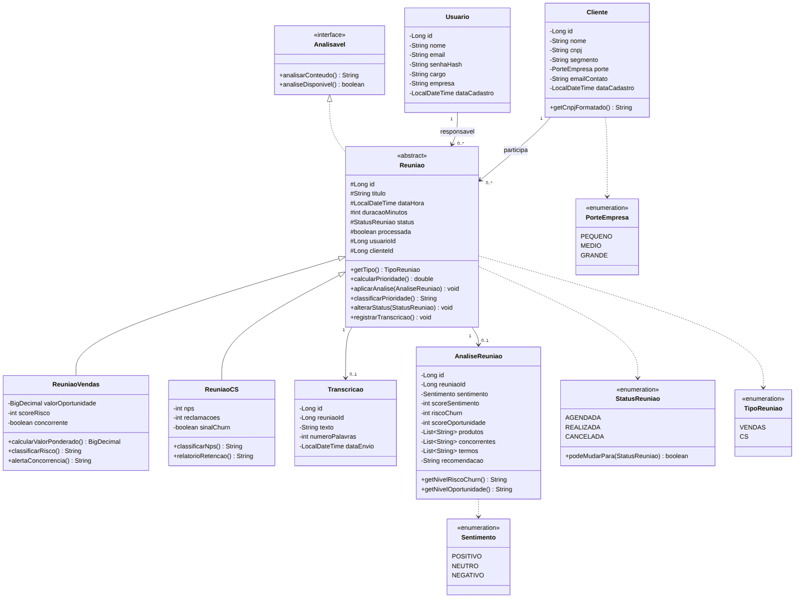
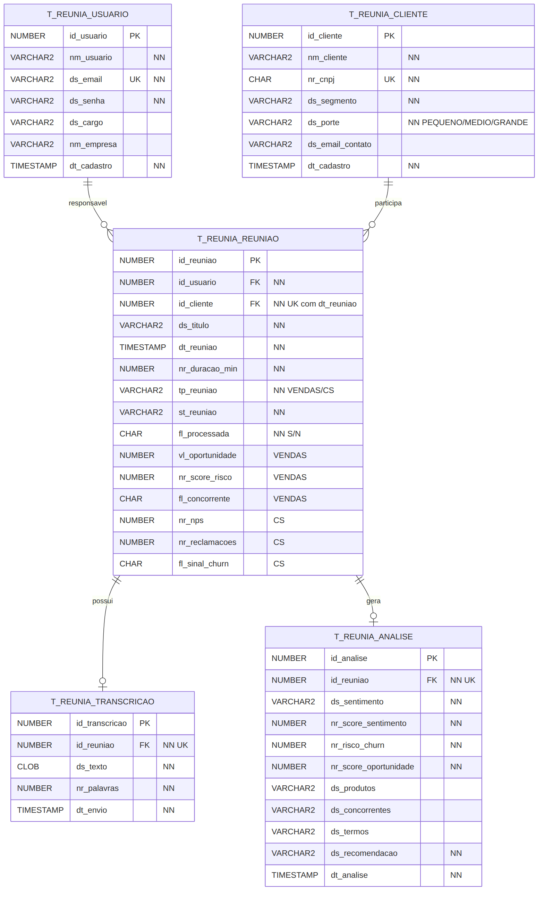

# Reun.IA — API Restful com Spring (Sprint 4 · Domain Driven Design Java)

Solução de **análise inteligente de reuniões comerciais** para o Challenge TOTVS 2026 (FIAP · Engenharia de Software · 2º ano).
A API cadastra usuários, clientes e reuniões (de **Vendas** ou de **Customer Success**) e, a partir da **transcrição** de uma reunião,
gera automaticamente: **sentimento, risco de churn (cancelamento), chance de venda, produtos TOTVS citados, concorrentes citados,
principais termos e recomendação de ação**.

## Tecnologias
- Spring Boot **4.1.0**, JDK **21**, projeto **Maven**
- Spring Web, Spring Boot DevTools, Spring Data JPA, Oracle Driver (ojdbc11), Bean Validation
- Thymeleaf + Bootstrap (telas)
- Insomnia (testes da API)

---

## Estrutura do projeto

```
src/main/java/br/com/fiap
├── ReuniaApplication.java          classe com o método main
├── controller                      @RestController (API) e telas Thymeleaf (ModelAndView)
├── exception                       NegocioException (regra de negócio violada)
├── model
│   ├── dto                         records com Bean Validation (dados que chegam em JSON)
│   ├── entity                      classes @Entity (tabelas do banco)
│   └── repository                  interfaces JpaRepository (acesso ao banco / DAO)
└── service                         validações e regras de negócio
src/main/resources
├── application.properties          configuração do banco de dados
└── templates                       páginas HTML (Thymeleaf + Bootstrap)
```

---

## Endpoints da API Restful

Todos recebem e devolvem **JSON**. Datas no formato `2026-11-20T14:00:00`.

| Recurso | Verbo | URI | Descrição | Status de resposta |
|---|---|---|---|---|
| Usuários | POST | `/usuarios` | Cadastra um usuário | 201, 400 |
| Usuários | POST | `/usuarios/login` | Login por e-mail e senha | 200, 400, 401 |
| Usuários | GET | `/usuarios` | Lista todos os usuários | 200 |
| Usuários | GET | `/usuarios/{codigo}` | Busca um usuário pelo código | 200, 404 |
| Usuários | GET | `/usuarios/{codigo}/reunioes` | Reuniões do usuário | 200, 404 |
| Usuários | PUT | `/usuarios/{codigo}` | Atualiza um usuário | 200, 400, 404 |
| Usuários | DELETE | `/usuarios/{codigo}` | Apaga um usuário sem reuniões | 200, 400, 404 |
| Clientes | POST | `/clientes` | Cadastra um cliente (CNPJ validado e único) | 201, 400 |
| Clientes | GET | `/clientes` | Lista todos os clientes | 200 |
| Clientes | GET | `/clientes/{codigo}` | Busca um cliente pelo código | 200, 404 |
| Clientes | GET | `/clientes/{codigo}/reunioes` | Histórico de reuniões do cliente | 200, 404 |
| Clientes | PUT | `/clientes/{codigo}` | Atualiza um cliente | 200, 400, 404 |
| Clientes | DELETE | `/clientes/{codigo}` | Apaga um cliente sem reuniões | 200, 400, 404 |
| Reuniões | POST | `/reunioes` | Agenda uma reunião de VENDAS ou CS | 201, 400 |
| Reuniões | GET | `/reunioes` | Lista todas as reuniões (com prioridade calculada) | 200 |
| Reuniões | GET | `/reunioes/{codigo}` | Busca uma reunião pelo código | 200, 404 |
| Reuniões | GET | `/reunioes/tipo/{tipo}` | Lista por tipo (VENDAS ou CS) | 200 |
| Reuniões | GET | `/reunioes/status/{status}` | Lista por status (AGENDADA, REALIZADA, CANCELADA) | 200 |
| Reuniões | GET | `/reunioes/prioritarias` | Fila de atendimento (prioridade ≥ 50) | 200 |
| Reuniões | PUT | `/reunioes/{codigo}` | Atualiza uma reunião | 200, 400, 404 |
| Reuniões | PUT | `/reunioes/{codigo}/status` | Altera o status da reunião | 200, 400, 404 |
| Reuniões | DELETE | `/reunioes/{codigo}` | Apaga a reunião (e sua transcrição/análise) | 200, 404 |
| Transcrição | POST | `/reunioes/{codigo}/transcricao` | Envia a transcrição e gera a análise | 201, 400, 404 |
| Transcrição | GET | `/reunioes/{codigo}/transcricao` | Consulta a transcrição | 200, 404 |
| Análise | GET | `/reunioes/{codigo}/analise` | Consulta a análise da reunião | 200, 404 |
| Análise | POST | `/analises/simular` | Analisa um texto sem salvar | 200, 400 |
| Dashboard | GET | `/dashboard` | Indicadores gerais | 200 |
| Dashboard | GET | `/dashboard/clientes-risco` | Clientes com risco de churn ≥ 60 | 200 |

**Códigos de status:** 200 OK · 201 CREATED · 400 BAD REQUEST (campo inválido no Bean Validation ou regra de negócio violada,
com a mensagem do erro) · 401 UNAUTHORIZED (login inválido) · 404 NOT FOUND (registro não encontrado) ·
500 INTERNAL SERVER ERROR (falha no servidor/banco).

---

## Telas (Thymeleaf + Bootstrap)

| URL | Tela |
|---|---|
| `/telas` | Painel com indicadores, fila de prioridade e clientes em risco |
| `/telas/clientes` e `/telas/clientes/novo` | Lista e cadastro de clientes |
| `/telas/reunioes` e `/telas/reunioes/novo` | Lista e agendamento de reuniões |
| `/telas/reunioes/{codigo}` | Detalhes da reunião, envio da transcrição e resultado da análise |

Prints das telas em [`docs/prints`](docs/prints).

---

## Regras de negócio
- **Prioridade de VENDAS** = valor ÷ 10.000 (até 50 pts) + risco × 0,3 + 20 pts se houver concorrente (máximo 100).
- **Prioridade de CS** = (10 − NPS) × 5 + reclamações × 8 + 30 pts se houver sinal de churn (máximo 100).
- **Classificação**: risco da negociação (VENDAS) ou cliente promotor/neutro/detrator pelo NPS (CS).
- **Status**: AGENDADA → REALIZADA ou CANCELADA; CANCELADA → AGENDADA (reagendar); REALIZADA não muda mais.
- **Transcrição**: reunião cancelada não recebe transcrição. Ao receber, a reunião vira REALIZADA.
- **Análise atualiza a reunião**: em VENDAS o risco vira a média entre o informado e o detectado, e concorrente citado liga o alerta;
  em CS, risco de churn ≥ 60 marca o sinal de churn.
- **Validações**: e-mail e CNPJ não podem repetir, CNPJ com dígitos verificadores válidos, o cliente não pode ter duas reuniões no
  mesmo horário, e não é possível apagar usuário ou cliente que tenha reuniões.

### Como a análise da transcrição funciona (`AnaliseService`)
1. Deixa o texto em minúsculas e sem acentos e separa as palavras.
2. Conta palavras positivas e negativas, com tratamento de negação ("não gostou" conta como negativa).
3. Procura sinais de cancelamento ("cancelar", "migrar para", "outro fornecedor"...) e de oportunidade ("proposta", "orçamento", "expandir"...).
4. Identifica produtos TOTVS (Protheus, RM, Fluig, Datasul...) e concorrentes (SAP, Sankhya, Omie...).
5. Calcula os indicadores de 0 a 100, pega os 5 termos mais repetidos e monta a recomendação.

---

## Diagramas

| Diagrama de classes | Modelo do banco de dados |
|---|---|
|  |  |
