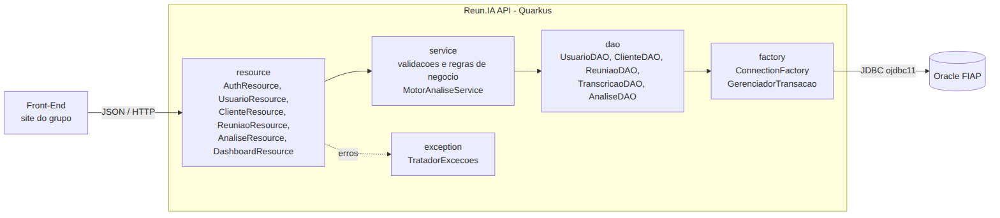

# Reun.IA — API RESTful (Sprint 4 · Domain Driven Design Java)

Solução de **análise inteligente de reuniões comerciais** para o Challenge TOTVS 2026 (FIAP · Engenharia de Software · 2º ano).
A API recebe a transcrição de uma reunião de Vendas ou de Customer Success e gera automaticamente indicadores para a área comercial:
**sentimento, risco de churn, potencial de oportunidade, produtos TOTVS citados, concorrentes citados, principais termos e recomendação de ação**.

Stack: **Java 21 · Quarkus 3.33 (JAX-RS / REST) · JDBC + Oracle (ojdbc11) · Maven · JUnit 5**

---

## 1. Como rodar

Pré-requisitos: **JDK 21 ou superior** (Maven não é obrigatório, o projeto traz o `mvnw`).

1. Rode o script [`database/reunia_oracle.sql`](database/reunia_oracle.sql) inteiro no SQL Developer (F5), conectado no Oracle da FIAP.
   Ele cria as 5 tabelas, constraints, comentários e insere os dados de exemplo. Pode ser executado de novo sem erro.
2. Abra [`ConnectionFactory.java`](src/main/java/br/com/fiap/reunia/factory/ConnectionFactory.java) e troque `SEU_RM` e `SUA_SENHA` pelo seu RM e senha do Oracle.
3. Suba a API:

```bash
./mvnw quarkus:dev          # Linux/Mac
mvnw.cmd quarkus:dev        # Windows
```

No IntelliJ: abra a pasta do projeto (ele reconhece o `pom.xml`) → aba Maven → `Plugins > quarkus > quarkus:dev`.

- API: http://localhost:8080
- Swagger UI (testar todos os endpoints pelo navegador): http://localhost:8080/q/swagger-ui
- Login de exemplo: `erick@totvs.com.br` / `Totvs@2026` (todos os usuários do script usam essa senha)

Testes automatizados: `./mvnw test` (16 testes: motor de análise, regras de negócio, validações e API).

> O driver JDBC do Oracle (`ojdbc11`) é baixado automaticamente pelo Maven. Isso corrige o erro
> "driver JDBC do Oracle não encontrado" da Sprint 3.

---

## 2. Arquitetura



| Pacote | Responsabilidade | Padrão |
|---|---|---|
| `model` | Entidades do domínio e regras de negócio (prioridade, risco, NPS, ciclo de status) | Herança, polimorfismo, interface `Analisavel`, enums |
| `dto` | Objetos de entrada/saída da API (ex.: usuário sem o hash da senha) | DTO / Record |
| `dao` | Acesso ao Oracle via JDBC com `PreparedStatement` | DAO |
| `service` | Validações, regras entre entidades, transações e motor de análise | Service, injeção de dependência (CDI) |
| `resource` | Endpoints REST (JAX-RS) | Controller REST |
| `factory` | `ConnectionFactory` e `GerenciadorTransacao` (commit/rollback) | Factory, Template Method |
| `exception` | Exceções de negócio + `TratadorExcecoes` que padroniza o JSON de erro | Exception Mapper |
| `util` | Hash de senha (SHA-256 + salt), validação de CNPJ/e-mail, normalização de texto | Utility class |

---

## 3. Endpoints da API

Todas as requisições e respostas usam `application/json`. Datas no formato ISO: `2026-10-20T09:30:00`.

| Recurso | Verbo | URI | Descrição | Status de resposta |
|---|---|---|---|---|
| Autenticação | POST | `/auth/login` | Login por e-mail e senha | 200, 400, 401 |
| Autenticação | POST | `/auth/cadastro` | Cadastro de novo usuário | 201, 400, 409 |
| Usuários | GET | `/usuarios` | Lista usuários | 200 |
| Usuários | GET | `/usuarios/{id}` | Busca usuário por id | 200, 404 |
| Usuários | GET | `/usuarios/{id}/reunioes` | Reuniões do usuário | 200, 404 |
| Usuários | POST | `/usuarios` | Cadastra usuário | 201, 400, 409 |
| Usuários | PUT | `/usuarios/{id}` | Atualiza usuário (senha opcional) | 200, 400, 404, 409 |
| Usuários | DELETE | `/usuarios/{id}` | Exclui usuário sem reuniões | 204, 404, 409 |
| Clientes | GET | `/clientes?nome=` | Lista clientes (filtro opcional por nome) | 200 |
| Clientes | GET | `/clientes/{id}` | Busca cliente por id | 200, 404 |
| Clientes | GET | `/clientes/{id}/reunioes` | Histórico de reuniões do cliente | 200, 404 |
| Clientes | POST | `/clientes` | Cadastra cliente (CNPJ validado e único) | 201, 400, 409 |
| Clientes | PUT | `/clientes/{id}` | Atualiza cliente | 200, 400, 404, 409 |
| Clientes | DELETE | `/clientes/{id}` | Exclui cliente sem reuniões | 204, 404, 409 |
| Reuniões | GET | `/reunioes?tipo=&status=&clienteId=&usuarioId=` | Lista com filtros opcionais | 200 |
| Reuniões | GET | `/reunioes/prioritarias?minimo=50` | Fila de atendimento por prioridade | 200, 400 |
| Reuniões | GET | `/reunioes/{id}` | Busca reunião com indicadores calculados | 200, 404 |
| Reuniões | POST | `/reunioes` | Agenda reunião de VENDAS ou CS | 201, 400, 409 |
| Reuniões | PUT | `/reunioes/{id}` | Atualiza reunião | 200, 400, 404, 409 |
| Reuniões | PATCH | `/reunioes/{id}/status` | Altera status (AGENDADA, REALIZADA, CANCELADA) | 200, 400, 404 |
| Reuniões | DELETE | `/reunioes/{id}` | Exclui reunião (e transcrição/análise) | 204, 404 |
| Transcrição | POST | `/reunioes/{id}/transcricao` | Envia transcrição e gera a análise | 201, 400, 404 |
| Transcrição | GET | `/reunioes/{id}/transcricao` | Consulta a transcrição | 200, 404 |
| Análise | GET | `/reunioes/{id}/analise` | Consulta a análise da reunião | 200, 404 |
| Análise | POST | `/analises/simular` | Analisa um texto sem salvar (pré-visualização) | 200, 400 |
| Dashboard | GET | `/dashboard/resumo` | Indicadores gerais (pipeline, NPS médio, sentimentos...) | 200 |
| Dashboard | GET | `/dashboard/clientes-risco?minimo=60` | Clientes com risco de churn | 200, 400 |

**Significado dos status:** 200 OK · 201 Created (com header `Location`) · 204 No Content · 400 dados inválidos ou regra de negócio violada ·
401 login inválido · 404 registro não encontrado · 409 duplicidade (e-mail, CNPJ, horário) ou registro com vínculos · 500 falha no banco.

Formato padrão de erro:

```json
{ "status": 409, "erro": "Conflict", "mensagem": "Já existe um cliente com o CNPJ 11.444.777/0001-61.", "timestamp": "2026-10-07T23:04:55" }
```

Exemplos prontos de requisições: [`docs/requisicoes.http`](docs/requisicoes.http) (abre direto no IntelliJ).

---

## 4. Regras de negócio

- **Prioridade de Vendas** = valor/10.000 (até 50 pts) + risco × 0,3 + 20 pts se houver concorrente. **Valor ponderado** = valor × (1 − risco).
- **Prioridade de CS** = (10 − NPS) × 5 + reclamações × 8 + 30 pts se houver sinal de churn (máx. 100). Classificação NPS em promotor, neutro ou detrator.
- **Ciclo de status**: AGENDADA → REALIZADA ou CANCELADA. CANCELADA → AGENDADA (reagendar). REALIZADA é final.
- **Transcrição**: reunião cancelada não recebe transcrição. Ao receber, a reunião vira REALIZADA e processada.
- **Análise aplicada à reunião**: em Vendas, o risco vira a média entre o informado e o detectado, e concorrente citado liga o alerta. Em CS, risco ≥ 60 marca sinal de churn.
- **Integridade**: e-mail e CNPJ únicos (CNPJ com dígito verificador), um cliente não tem duas reuniões no mesmo horário, e não se exclui usuário ou cliente com reuniões.
- **Login**: senha guardada como hash SHA-256 com salt, nunca em texto puro.

### Motor de análise (`MotorAnaliseService`)
Fluxo sugerido pela disciplina de Data Science: **Transcrição → Processamento → Indicadores → Recomendação**.
1. Normaliza o texto (minúsculas, sem acento) e separa em palavras.
2. Conta palavras positivas e negativas, com **tratamento de negação** ("não gostou" conta como negativo).
3. Detecta sinais de churn ("cancelar", "migrar para", "outro fornecedor"...) e de oportunidade ("proposta", "orçamento", "expandir"...).
4. Identifica produtos TOTVS (Protheus, RM, Fluig, Datasul, Logix, Winthor...) e concorrentes (SAP, Sankhya, Omie, NetSuite...).
5. Calcula os scores de 0 a 100, extrai os 5 termos mais frequentes e gera a recomendação de ação.

---

## 5. Modelo de dados e diagrama de classes

| Diagrama de classes | Modelo do banco |
|---|---|
|  |  |

Os arquivos-fonte `.mmd` (Mermaid) ficam em `docs/` caso precisem ser editados.
